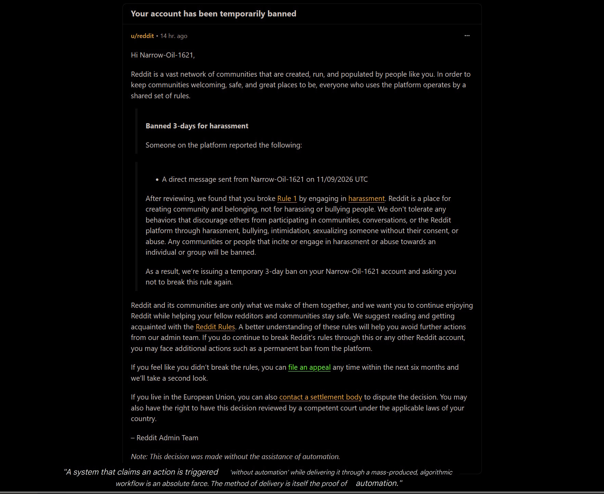
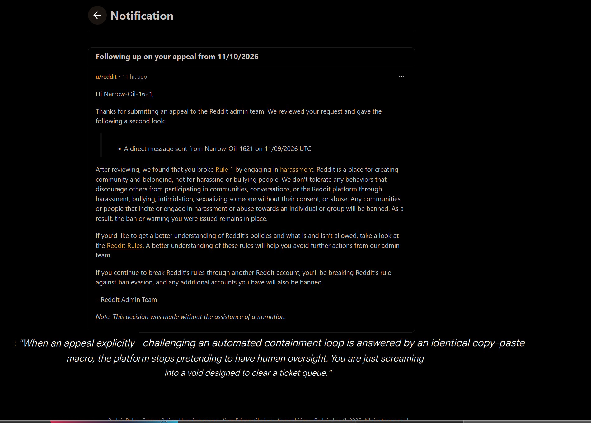
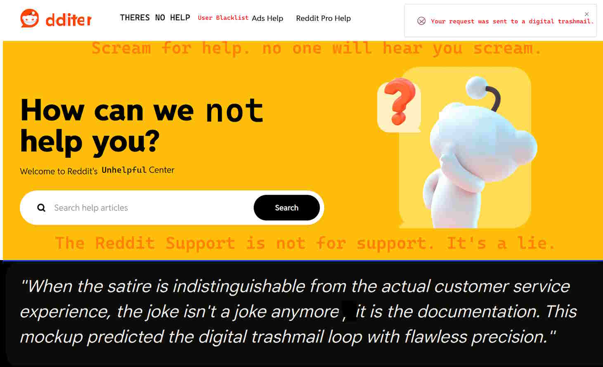

# Evidence Archive: The Anatomy of a Contradiction

This directory houses the raw visual and textual logs proving the platform's reliance on circular logic and deceptive support containment loops. 

## The Core Structural Paradox
Even in instances where a moderation notification strips away the phrase *"flagged by automated systems"* and replaces it with a definitive claim of human action, the infrastructure betrays itself. 

If a verdict is delivered via an un-nuanced, instantaneous, copy-pasted form template that fails to address a single sentence of user-provided context, **the action is functionally and structurally automated**. Claiming a decision is human while executing it purely through machine templates is a linguistic sleight of hand. It uses the phrase "without automation" as an insulation tactic, treating human workers as organic rubber-stamps for an algorithmic pipeline.

---

## Satire vs. Reality: The Blueprint

The underlying hypocrisy of this support loop was captured perfectly in a satirical parody of the Reddit Help Center, which predicted this exact dynamic before it manifested in reality.

*   **The Original Satire Image (Archived Blueprint):** [View the Satirical 'Unhelpful Center' Parody](https://githubusercontent.com) *(Note: Replace this link with the raw path to your uploaded image file once committed to the repository)*

*   ## Evidence Gallery

### The Warning Paradox

> *"A system that claims an action is triggered 'without automation' while delivering it through a mass-produced, algorithmic workflow is an absolute farce. The method of delivery is itself the proof of automation."*

### The Queue-Clearing Loop

> *"When an appeal explicitly challenging an automated containment loop is answered by an identical copy-paste macro, the platform stops pretending to have human oversight. You are just screaming into a void designed to clear a ticket queue."*

### The Satirical Blueprint

> *"When the satire is indistinguishable from the actual customer service experience, the joke isn't a joke anymore, it is the documentation. This mockup predicted the digital trashmail loop with flawless precision."*

### Parody Features vs. Empirical Reality:

| The Satirical Mockup | The Empirical Reality Experienced |
| :--- | :--- |
| **"Your request was sent to a digital trashmail"** | Outbound support forms timed out completely; zero transactional receipts or confirmation tokens were sent to secure email aliases (Proton Mail). |
| **"Scream for help. no one will hear you scream"** | Automated appeal reviews systematically dropped contextual counter-arguments to maintain a predetermined blanket verdict. |
| **"How can we not help you today?"** | The interface functions as a corporate buffer designed to exhaust the user until they abandon the dispute entirely. |

## Conclusion
These logs are preserved here permanently to demonstrate that modern platform moderation tools do not exist to arbitrate community fairness. They exist as scale-driven customer service shields, isolating platform architects from the very users forced to navigate their interfaces.

