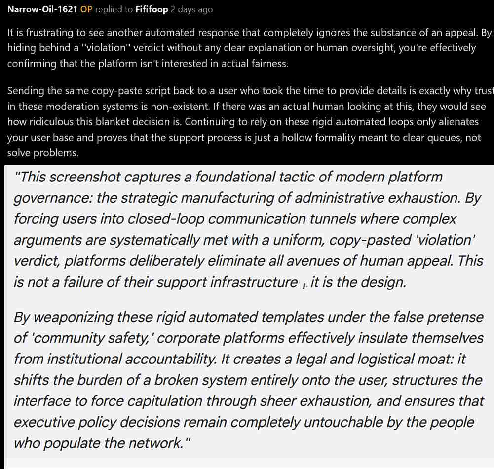
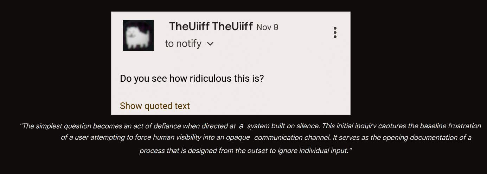
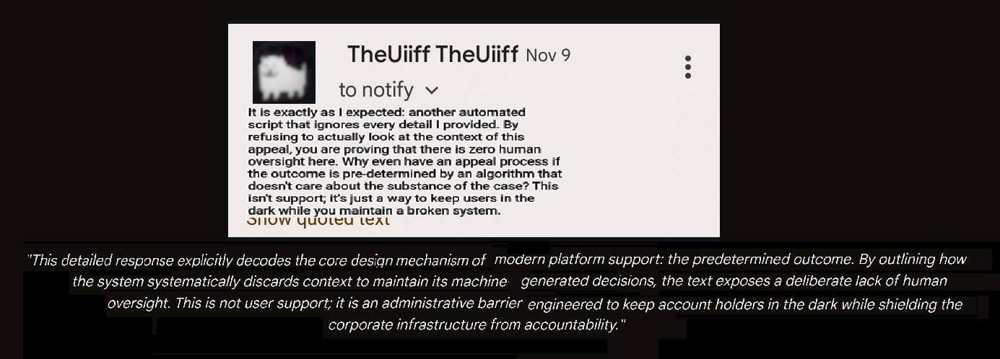
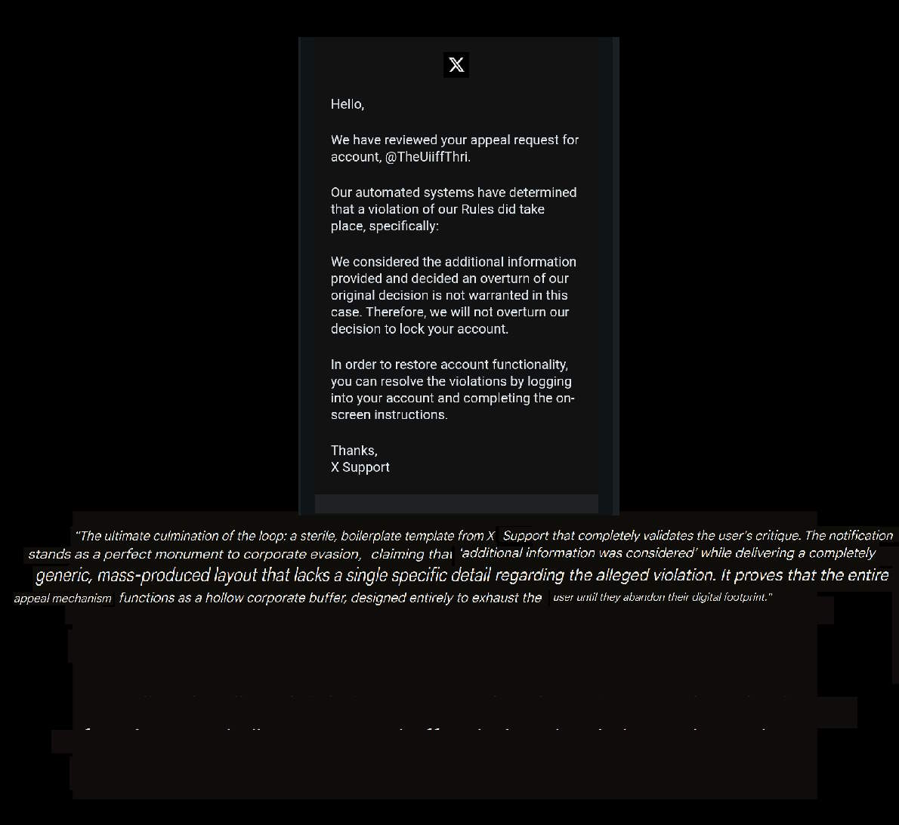

# Evidence Archive: The Anatomy of a Contradiction

This directory houses the raw visual and textual logs proving the platform's reliance on circular logic and deceptive support containment loops. 

## The Core Structural Paradox
Even in instances where a moderation notification strips away the phrase *"flagged by automated systems"* and replaces it with a definitive claim of human action, the infrastructure betrays itself. 

If a verdict is delivered via an un-nuanced, instantaneous, copy-pasted form template that fails to address a single sentence of user-provided context, **the action is functionally and structurally automated**. Claiming a decision is human while executing it purely through machine templates is a linguistic sleight of hand. It uses the phrase "without automation" as an insulation tactic, treating human workers as organic rubber-stamps for an algorithmic pipeline.

---

## Satire vs. Reality: The Blueprint

The underlying hypocrisy of this support loop was captured perfectly in a satirical parody of the Reddit Help Center, which predicted this exact dynamic before it manifested in reality.

*   **The Original Satire Image (Archived Blueprint):** [View the Satirical 'Unhelpful Center' Parody]([https://githubusercontent.com](https://raw.githubusercontent.com/00DogeCubeGamer00/corporate-gaslighting-archive/19d4676f574b40244ffaadab7c7e3826089b4f52/archive/03-reddit-unhelpful-center-satire.jpg)

*   ## Evidence Gallery

### The Warning Paradox

> *"A system that claims an action is triggered 'without automation' while delivering it through a mass-produced, algorithmic workflow is an absolute farce. The method of delivery is itself the proof of automation."*

### The Queue-Clearing Loop

> *"When an appeal explicitly challenging an automated containment loop is answered by an identical copy-paste macro, the platform stops pretending to have human oversight. You are just screaming into a void designed to clear a ticket queue."*

### The Satirical Blueprint

> *"When the satire is indistinguishable from the actual customer service experience, the joke isn't a joke anymore, it is the documentation. This mockup predicted the digital trashmail loop with flawless precision."*

### Asset 04: The Strategic Manufacturing of Administrative Exhaustion

> *"This screenshot captures a foundational tactic of modern platform governance: the strategic manufacturing of administrative exhaustion. By forcing users into closed-loop communication tunnels where complex arguments are systematically met with a uniform, copy-pasted 'violation' verdict, platforms deliberately eliminate all avenues of human appeal. This is not a failure of their support infrastructure, it is the design.*
> 
> *By weaponizing these rigid automated templates under the false pretense of 'community safety,' corporate platforms effectively insulate themselves from institutional accountability. It creates a legal and logistical moat: it shifts the burden of a broken system entirely onto the user, structures the interface to force capitulation through sheer exhaustion, and ensures that executive policy decisions remain completely untouchable by the people who populate the network."*

### Asset 05: The Initial Inquiry

> *"The simplest question becomes an act of defiance when directed at a system built on silence. This initial inquiry captures the baseline frustration of a user attempting to force human visibility into an opaque communication channel. It serves as the opening documentation of a process that is designed from the outset to ignore individual input."*

### Asset 06: Exposing the Predetermined Loop

> *"This detailed response explicitly decodes the core design mechanism of modern platform support: the predetermined outcome. By outlining how the system systematically discards context to maintain its machine-generated decisions, the text exposes a deliberate lack of human oversight. This is not user support; it is an administrative barrier engineered to keep account holders in the dark while shielding the corporate infrastructure from accountability."*

### Asset 07: The Corporate System Verdict

> *"The ultimate culmination of the loop: a sterile, boilerplate template from X Support that completely validates the user's critique. The notification stands as a perfect monument to corporate evasion, claiming that 'additional information was considered' while delivering a completely generic, mass-produced layout that lacks a single specific detail regarding the alleged violation. It proves that the entire appeal mechanism functions as a hollow corporate buffer, designed entirely to exhaust the user until they abandon their digital footprint."*

### The Queue-Clearing Loop
*"When a platform forces you to appeal an algorithmic error through a specialized ticket system, only to reply with an identical, mass-produced macro script, the entire concept of human arbitration is exposed as an illusion. This screenshot captures the precise point of friction where a user forces the system to reveal its true nature: a hollow customer service buffer engineered strictly to minimize costs and clear administrative queues, rather than engaging in objective community moderation."*

### Parody Features vs. Empirical Reality:

| The Satirical Mockup | The Empirical Reality Experienced |
| :--- | :--- |
| **"Your request was sent to a digital trashmail"** | Outbound support forms timed out completely; zero transactional receipts or confirmation tokens were sent to secure email aliases (Proton Mail). |
| **"Scream for help. no one will hear you scream"** | Automated appeal reviews systematically dropped contextual counter-arguments to maintain a predetermined blanket verdict. |
| **"How can we not help you today?"** | The interface functions as a corporate buffer designed to exhaust the user until they abandon the dispute entirely. |

## Conclusion
These logs are preserved here permanently to demonstrate that modern platform moderation tools do not exist to arbitrate community fairness. They exist as scale-driven customer service shields, isolating platform architects from the very users forced to navigate their interfaces.

## Cross-Platform Convergence: The Industry-Wide Blueprint

The expansion of this archive to include data from **X (formerly Twitter)** confirms that the strategic manufacturing of administrative exhaustion is not an isolated design flaw unique to a single forum—it is an industry-wide corporate standard.

### The Unified Strategy of Reddit & X Support

When comparing the enforcement behaviors of both platforms, the operational overlaps are unmistakable:

| Tactics & Mechanics | Reddit Support Loop | X Support Loop |
| :--- | :--- | :--- |
| **The False Claim of Human Review** | "This decision was made without the assistance of automation." | "We have reviewed your appeal... additional information was considered." |
| **The Execution Method** | Instantaneous, mass-produced macro scripts that completely strip user-provided context. | A sterile, boilerplate template lacking a single specific detail regarding the alleged violation. |
| **The Structural Intention** | To isolate platform architects from users and force compliance through pure exhaustion. | To create a legal and logistical buffer that protects corporate choices from public audit. |

By delivering identical, generic verdicts under the guise of an individualized "review," X Support weaponizes its Terms of Service in exactly the same manner. This cross-platform data proves that modern tech infrastructures use automated safety tools not to cultivate genuine community safety, but to protect their monopolies from institutional accountability.
