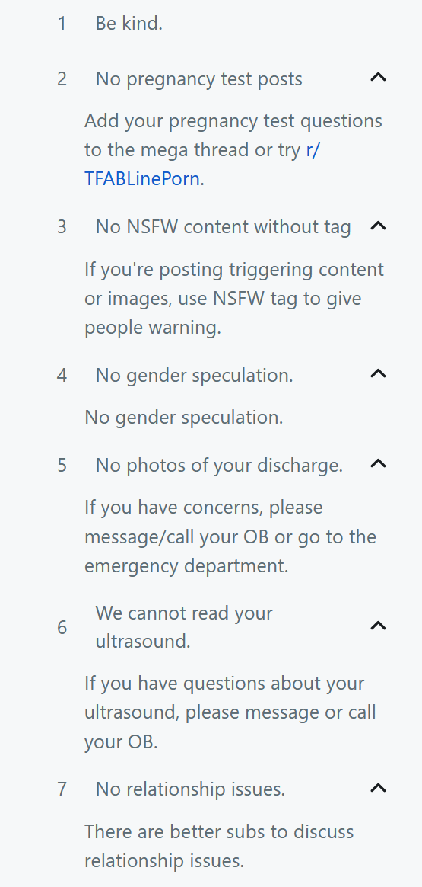
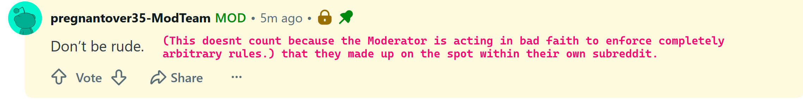
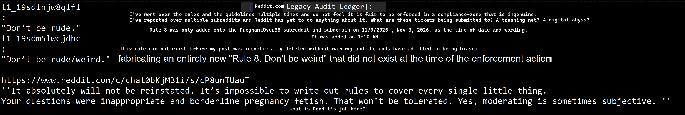
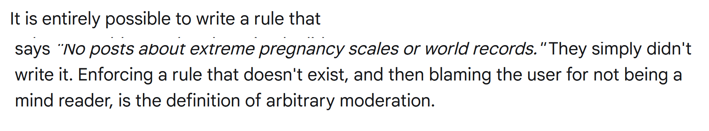

# Case Study: Subreddit Policy Manipulation & Abuse of Power

This directory houses an immutable digital paper trail and compliance audit ledger tracking a verified breach of Rule 2 of the platform-level Moderator Code of Conduct. It documents the tactical workflow used by online gatekeepers to enforce personal bias under the guise of institutional rules.

## The Timeline of the Compliance Failure

1. **The Rule-Compliant Input:** A safe submission inquiring about historical world records, physical scales, and positive pregnancy reflections was published. The text explicitly requested that cynical points of view stay out.
2. **The Subjective Deletion:** The post was removed despite violating zero of the community's 7 public sidebar rules.
3. **The Public False Front:** The mod team left a public sticky note claiming a violation of "Don't be rude," using a generic template to misrepresent the reason for deletion to the community.
4. **The Private Confession:** In secure modmail channels, the gatekeepers dropped the fake public excuse. A moderator explicitly admitted that the enforcement was entirely "subjective" and personally labeled historical curiosity as inappropriate.
5. **Retroactive Rule Fabrication:** Upon realizing they had no structural footing, the team scrambled behind the scenes to rewrite the public stylesheet, inventing a brand new "Rule 8" to retroactively validate an enforcement choice made days prior.

---

## Visual Ledger & Evidence Tracking

### Item 01: The Published Contract

> "If a user follows all 7 written rules perfectly and still gets banned because a moderator personally finds a topic uncomfortable, the community is not operating in good faith."

### Item 02: The Public Distraction

> "The team made up rules on the spot, using a public placeholder comment ('Don't be rude') to disguise arbitrary personal whims."

### Item 03: The Core Confession

> "The absolute smoking gun. This text captures the moment the gatekeepers abandon their own public rulebook, admitting that their moderation is entirely subjective while using a closed communication network to stonewall an objective inquiry."

### Item 04: The Accountability Metric

> "Enforcing a rule that doesn't exist, and then blaming the user for not being a mind reader, is the exact definition of arbitrary digital fiefdoms. Last-minute edits to stylesheets cannot erase a timeline that has already been locally logged."

